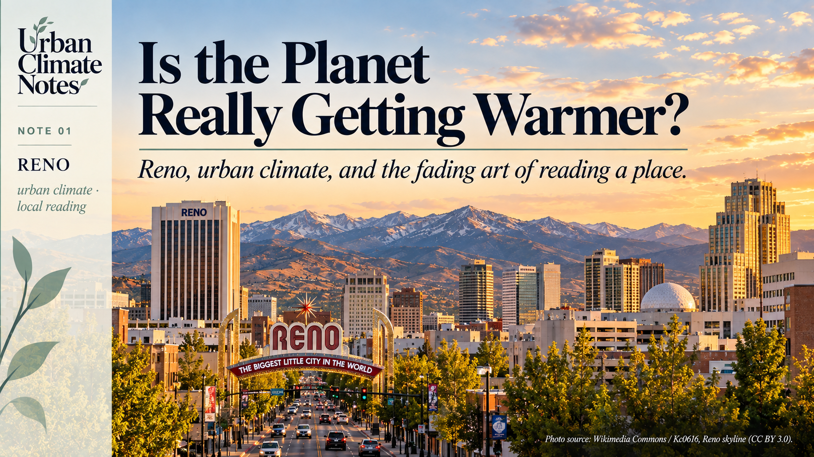
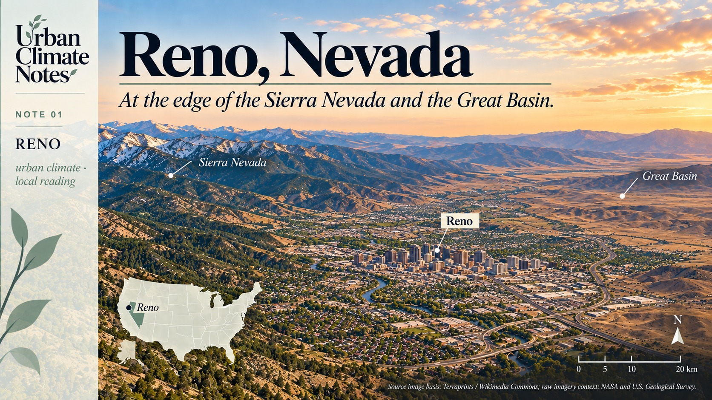
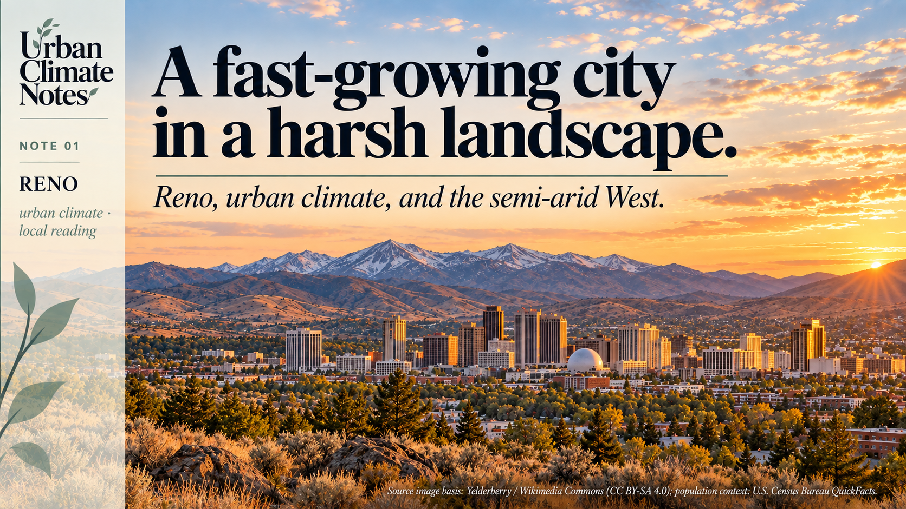
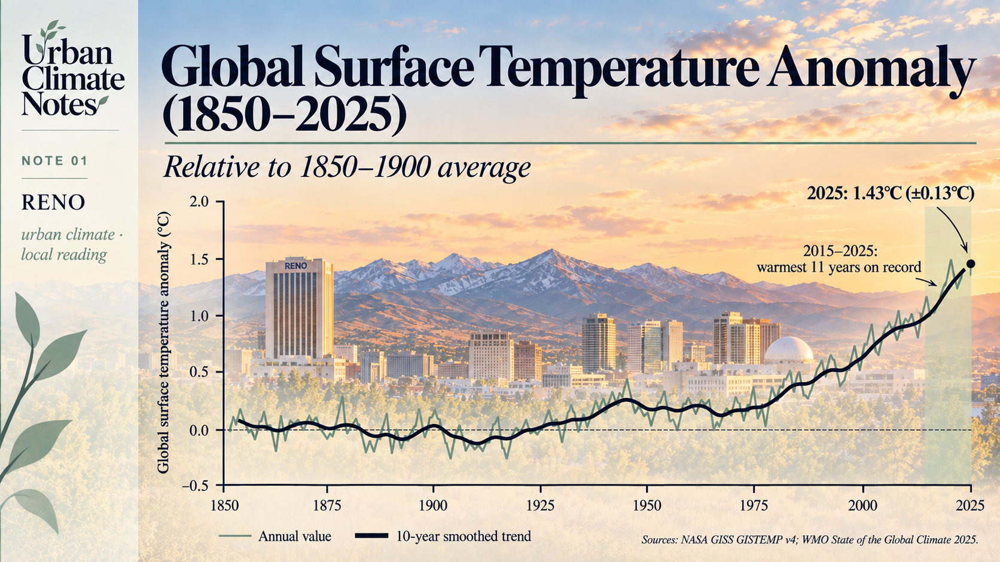

{width="100%" fig-alt="Urban Climate Notes 01. Is the Planet Really Getting Warmer?"}

Climate Central placed Reno, Nevada, at the top of its 2026 ranking of 242 U.S. cities for warming since 1970. Its estimated increase was **7.9°F, approximately 4.4°C** [3]. Reno calls itself “The Biggest Little City in the World”, a nickname displayed on its famous arch [2]. For a place with “little” in its name, that is a rather large number.

I wanted to understand how it was calculated, and what, if anything, it told us about the way Reno has grown.

## What does the ranking measure?

Climate Central is an independent, nonprofit group of scientists and communicators working on climate change. Its researchers examined annual average temperatures in weather-station records provided by the National Oceanic and Atmospheric Administration (NOAA). For each city, they fitted a linear trend to the period 1970–2025 [3].

The 7.9°F estimate is the change indicated by that fitted line over the study period. It is not simply the temperature in 2025 minus the temperature in 1970. All the intervening years contribute to the calculation. That matters when some years are exceptionally hot or cold, and it is why the choice of starting and ending years deserves attention.

Las Vegas came second at +6.0°F, followed by El Paso at +5.9°F. Burlington, Vermont, and Tyler, Texas, were next at +5.3°F each [3]. Burlington's presence alongside the Nevada and Texas cities is interesting. These places have markedly different regional climates, yet the same calculation places them on one list. The ranking tells us where the trends were largest in these records. It does not, by itself, explain their causes.

## Reno's place on the map

{width="100%" fig-alt="Reno, Nevada, between the Sierra Nevada and the Great Basin"}

Reno, Nevada, in its regional landscape context, between the Sierra Nevada and the Great Basin.

Reno lies east of the Sierra Nevada. Much of the moisture brought inland from the Pacific falls as precipitation on the western side of the mountains; the eastern side is comparatively dry. This is the *rain-shadow effect*. The Truckee River valley, the mountains and the wider Great Basin all belong to the climatic setting in which Reno developed [4].

The city has grown considerably. Its population rose from 225,221 in 2010 to an estimated 283,621 in 2025, about 26% [5]. More people require homes, roads and other urban infrastructure, but population figures cannot tell us how much this development contributed to the 1970–2025 temperature trend. They cover only the latter part of that period and say little about the physical changes around the measuring station.

{width="100%" fig-alt="Reno skyline and the surrounding semi-arid mountain landscape"}

Reno is a fast-growing city within a semi-arid landscape shaped by the Sierra Nevada and the Great Basin.

To investigate further, I would begin with historical aerial photographs and satellite images. Where did new housing and commercial areas appear? How much vegetation was replaced by roofs and paved surfaces? I would also locate the weather station and examine whether its immediate surroundings changed. We should know something about the place where a temperature is measured before using the number to describe a whole city.

Another step would be to compare Reno's record with stations in less urbanised surroundings, controlling as far as possible for elevation, location and continuity of observations. If they showed a similar trend, that would strengthen the case for regional influences. A larger trend in Reno would give us a reason to examine local conditions more closely, without automatically proving that urbanisation caused the difference.

This also helps distinguish two concepts that are often mixed together. The *urban heat island* describes a temperature difference between an urban area and a less urbanised reference, commonly most pronounced in air temperature at night. Reno's reported 4.4°C is a long-term trend estimated from a local station record, not a direct measurement of that urban–rural difference.

## A local number and a warming planet

The title asks whether the planet is really getting warmer. According to the World Meteorological Organization, 2015–2025 were the eleven warmest years in the observational record. The global mean near-surface temperature in 2025 was about 1.43°C above the 1850–1900 average, with an uncertainty of ±0.13°C [6]. The IPCC concludes that human activities have unequivocally caused global warming [7].

An individual year can still be cooler than the year before. Natural variability does not disappear because the longer trend is upwards.

{width="100%" fig-alt="Global surface temperature anomaly from 1850 to 2025"}

Global warming is a long-term trend rather than the result of a single hot year.

Reno's 4.4°C and the global 1.43°C should not be divided to claim that Reno is warming three times faster. The first is a trend estimate over 1970–2025 at a local station. The second is a global anomaly for one year relative to 1850–1900. The periods, geographical coverage and calculations differ. Land areas also generally warm faster than the global average, which includes the oceans. A meaningful comparison would require compatible temperature records analysed over the same years.

For a planning student, there is a useful lesson in this distinction. Before comparing two numbers, find out precisely what was measured, where, when and how the result was calculated.

## What could a planner learn from this?

Urban morphology is the arrangement of buildings, streets and open spaces: their heights, widths, spacing and orientation. It influences shade, radiation exchange and wind. Land cover, water, vegetation and heat released by human activity also affect urban thermal conditions [8]. Those relationships help us understand why two streets within the same city can behave differently, even when both experience the same regional warming.

Measurements are only part of that investigation. A resident might say that an upstairs room becomes unbearable in August, or that floodwater repeatedly collects at the same corner. These statements do not establish a temperature trend or replace a hydraulic model, but they identify experiences and locations that deserve closer examination.

I keep returning to a recollection by Benny Fillmore, a Washoe elder: “There was a time when everything … all had a voice and we were able to understand” [1]. He was speaking in the context of relationships with land, knowledge and stewardship around Lake Tahoe. His words are not a climate measurement, and I would not use them to explain Reno's temperature ranking. I take from them an invitation to pay attention to what people have learned from living in a particular landscape.

Today we can bring together station records, satellite images, field observations and residents' accounts. Each offers different evidence. Working across them is one way to understand how global warming, regional climate and the built environment meet in the places we plan.

Reno's ranking is a good reason to start looking. The more interesting work begins when we open the map.

---

## Sources

**[1]** Center for the Study of the Force Majeure. [*Stewarding Knowledges*](https://www.centerforforcemajeure.org/stewarding-knowledges). Benny Fillmore, Washoe Elder, and the initiative’s Washoe-led stewardship context.

**[2]** City of Reno. [*Historic Markers*](https://reno.gov/community/arts-culture/historic-preservation/historic-markers.php). Reno’s nickname and historic arch.

**[3]** Climate Central. [*Fastest-Warming U.S. States and Cities*](https://www.climatecentral.org/climate-matters/fastest-warming-us-cities-and-states). April 22, 2026. The reported changes are based on linear regression of annual average weather-station temperatures over 1970–2025.

**[4]** National Weather Service. [*Climate of Reno, Nevada*](https://preview.weather.gov/media/wrh/online_publications/TMs/TM-276.pdf). Western Region Technical Memorandum 276.

**[5]** U.S. Census Bureau. [*QuickFacts: Reno city, Nevada*](https://www.census.gov/quickfacts/renocitynevada). 2010 census count and July 1, 2025 population estimate, V2025. Percentage growth calculated from the two figures.

**[6]** World Meteorological Organization. [*State of the Global Climate 2025*](https://wmo.int/publication-series/state-of-global-climate/state-of-global-climate-2025). 2026.

**[7]** IPCC. [*Climate Change 2023: Synthesis Report*](https://www.ipcc.ch/report/ar6/syr/downloads/report/IPCC_AR6_SYR_FullVolume.pdf). Summary for Policymakers and Section 2.1.1.

**[8]** IPCC. [*AR6 Working Group I: Regional Fact Sheet: Urban Areas*](https://www.ipcc.ch/report/ar6/wg1/downloads/factsheets/IPCC_AR6_WGI_Regional_Fact_Sheet_Urban_areas.pdf). 2021.