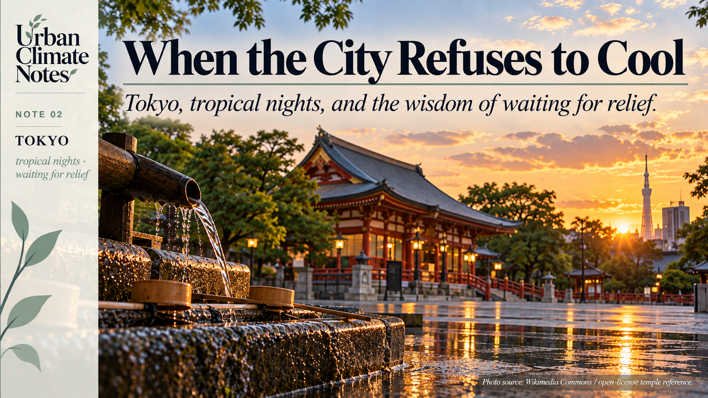
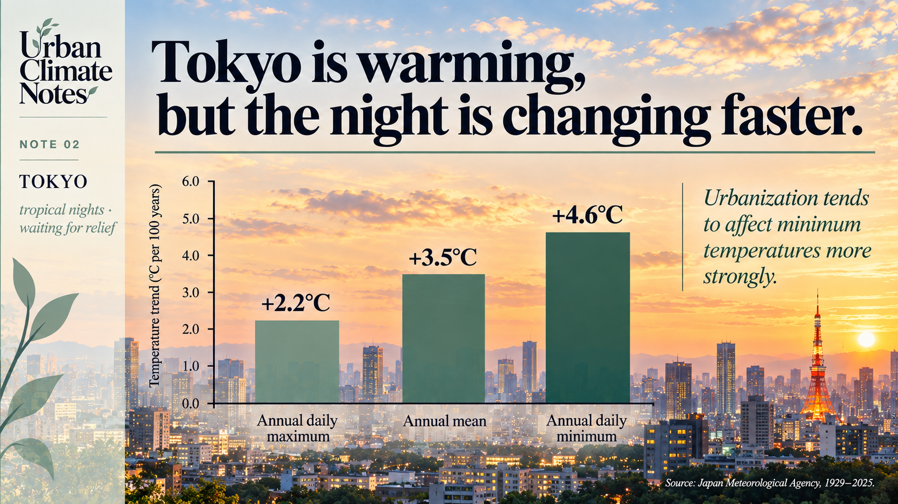
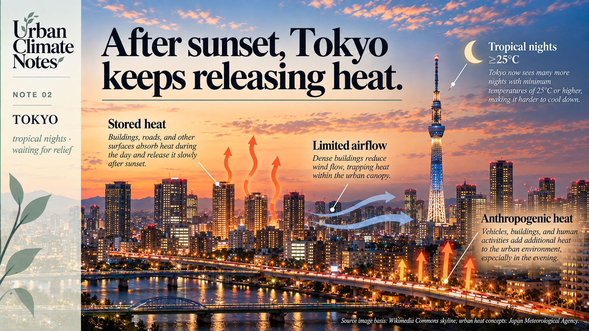
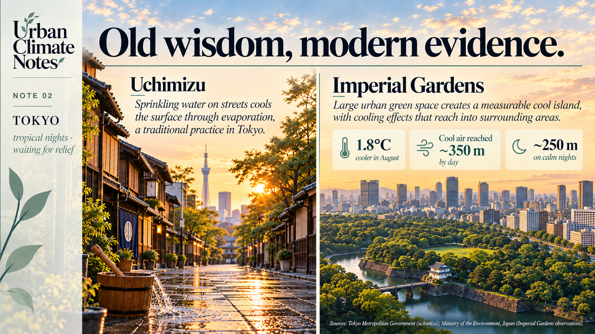

{width="100%" fig-alt="Urban Climate Notes 02. When the City Refuses to Cool"}

There is a Japanese saying that places a reassuring limit on uncomfortable weather: *Atsusa samusa mo higan made.* The heat and the cold last only until Higan, the seven-day period centred on each equinox, associated with Buddhist observances and remembrance of ancestors. Summer’s lingering heat will ease around the autumn equinox; winter’s cold will soften around the spring equinox. [1]

I like the idea that a sentence can hold both memory and a forecast. People have lived through enough seasons to recognise when relief usually arrives, and that expectation has found its way into everyday language. In a hot bedroom, though, the wait is usually shorter. We would settle for some cooler air through the window after sunset.

## What happens after sunset?

For 1929–2025, the Japan Meteorological Agency reports a warming trend of approximately 3.5°C per century in Tokyo’s annual mean temperature. The annual averages of daily maximum and minimum temperature have risen at different rates: about 2.2°C and 4.6°C per century, respectively. [2] The minimum has increased considerably faster. These annual statistics include all seasons, and JMA adjusts the series for the relocation of the observing station. They describe changes in Tokyo’s temperature record, with contributions from the broader warming climate and local urban conditions.

{width="100%" fig-alt="Tokyo long-term temperature trends from 1929 to 2025"}

Annual averages of daily minimum temperature have increased faster than annual averages of daily maximum temperature in Tokyo over 1929–2025. Source: JMA. [2]

A street can remain warm long after the sunlight has left it. Walls and pavement absorb energy during the day, then release some of that stored heat into the surrounding air. Between buildings, cooling also depends on how much sky is visible and how freely air can move. Vegetation and available moisture influence how much energy goes into evaporation, while human activities add heat. JMA identifies these among the processes behind urban warming. [3]

Together, these processes help explain the urban heat island, the relative warmth of an urban area compared with a less urbanised reference under comparable conditions. Reducing greenhouse gas emissions addresses the broader warming trajectory; the layout and materials of a neighbourhood influence how that particular place heats and cools.

{width="100%" fig-alt="Conceptual illustration of stored heat, limited airflow and anthropogenic heat in Tokyo after sunset"}

Conceptual illustration of processes that can slow urban cooling after sunset; it does not present measured temperatures or a mapped observation.

Japanese meteorological language gives a warm night a memorable name. A *tropical night* is one when the temperature from evening until the following morning stays at or above 25°C. [4] The name sounds almost inviting until you imagine turning the pillow over and discovering that the air outside offers little relief. Humidity and air movement affect how such a night feels, so 25°C cannot mark the same boundary of comfort for everyone.

JMA’s long-term analysis shows increasing numbers of days with minimum temperatures of at least 25°C in several major Japanese cities. Tokyo is excluded from that particular comparison because its station relocation complicates the analysis of threshold counts. [5]

## Water at the doorstep, cooler air beyond the garden

Tokyo has an older response to summer heat: *uchimizu*, the sprinkling of water onto the ground. The Tokyo Metropolitan Government describes it as “Edo wisdom” and traces the practice through Edo-period haiku and ukiyo-e. People sprinkled water to cool surfaces and settle dust, and also to prepare an entrance for guests or cleanse a space. [6] Making a place cooler could be a way of welcoming someone.

As the water evaporates, it draws energy from its surroundings and can cool the wetted surface. Tokyo’s guidance recommends reused water, sprinkled in shaded places during the morning or evening. [6] The advice is specific about timing and location, and the effect depends on conditions. It asks people to pay attention to the ground outside their own door, using water that has already served another purpose.

At a much larger scale, observations around Tokyo’s Imperial Gardens show how cooling can extend into neighbouring streets. In August 2007, researchers working with Japan’s Ministry of the Environment found that the gardens’ average temperature was 1.8°C lower than that of the surrounding built-up area. They detected cooler air extending up to approximately 350 metres into neighbouring urban areas during the day, and up to approximately 250 metres from midnight into early morning under calm conditions. [7]

{width="100%" fig-alt="Uchimizu and the cooling influence of Tokyo Imperial Gardens"}

Uchimizu and observations around the Imperial Gardens illustrate cooling at different scales. The garden measurements come from August 2007. [6, 7]

Those distances belong to that observation campaign; the surroundings and weather will affect what happens at another park. The measurements show that cooler air extended beyond the garden boundary. A land-use plan draws a line around the green space. For a planner, the observations raise questions about the streets and buildings along it, and how their arrangement might affect cooling in the surrounding neighbourhood.

## Planning for the evening

We experience climate in rooms, streets and courtyards. A shaded pavement can make an afternoon walk easier, while the same street’s ventilation and release of stored heat affect what happens later. Assessing a building arrangement therefore means following it through the hours when people use the surrounding spaces, including the evening.

The Higan saying expresses an expectation about the turn of the seasons. Tokyo’s annual temperature trends concern a different timescale and cannot tell us whether that expectation still holds around the equinoxes. They do, however, show why the cooler part of the day needs attention alongside the hottest hours.

In planning, I want to know what happens to the places we build when evening comes. Can cooler air reach the nearby homes? Does the street begin to lose the heat it stored? Someone opening a window tonight will find out long before the next season arrives.

## Sources

[1] Shogakukan dictionaries, via Kotobank. [暑さ寒さも彼岸まで](https://kotobank.jp/word/暑さ寒さも彼岸まで-425482) and [彼岸](https://kotobank.jp/word/彼岸-119265). Meaning of the proverb and the Higan period.

[2] Japan Meteorological Agency. [Urbanisation and long-term trends in mean, maximum and minimum temperature](https://www.data.jma.go.jp/cpdinfo/himr/himr_1-1-1.html). 1929–2025; annual and seasonal trends, with relocation adjustments for Tokyo.

[3] Japan Meteorological Agency. [What causes the urban heat island?](https://www.jma.go.jp/jma/kishou/know/cpdinfo/himr_faq/02/qa.html). Heat storage, land cover, urban geometry and anthropogenic heat.

[4] Japan Meteorological Agency. [Frequently asked questions about temperature](https://www.jma.go.jp/jma/kishou/know/faq/faq3.html). Definition of a tropical night.

[5] Japan Meteorological Agency. [Long-term changes in temperature-category day counts](https://www.data.jma.go.jp/cpdinfo/himr/himr_1-3.html). This analysis uses daily minimum temperature ≥25°C, whereas the definition of a tropical night covers evening to the following morning. Tokyo is excluded because of station-relocation effects.

[6] Tokyo Metropolitan Government. [Uchimizu Biyori](https://wbgt.metro.tokyo.lg.jp/effort/uchimizu/). Cultural history, evaporative cooling and recommended practice.

[7] Ministry of the Environment, Japan. [Observation of the “Cool Island Effect” in the Imperial Gardens](https://www.env.go.jp/en/headline/560.html). October 4, 2007; results from observations in August 2007.
