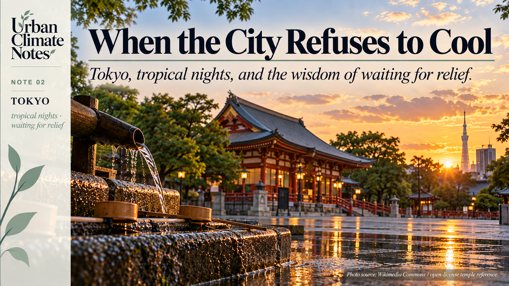
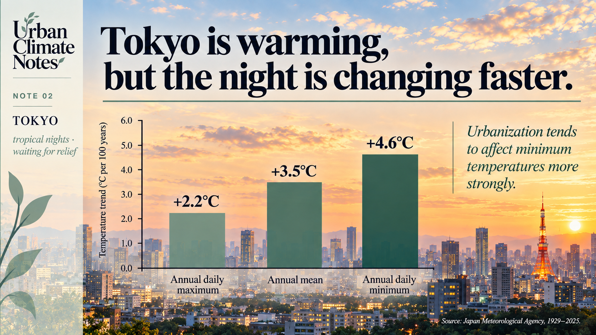
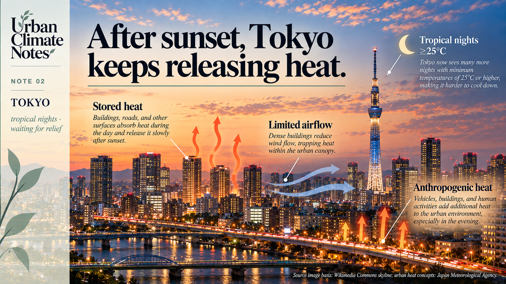
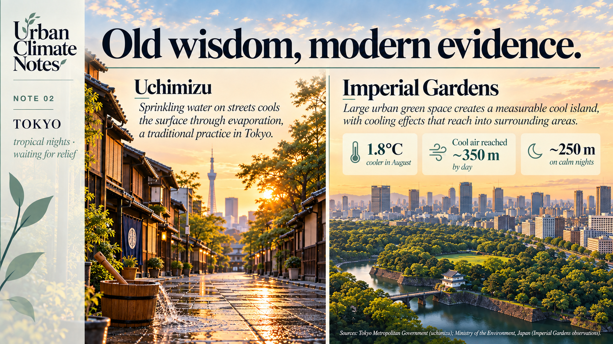

{width="100%" fig-alt="Urban Climate Notes 02. When the City Refuses to Cool"}

> 暑さ寒さも彼岸まで。
>
> *Atsusa samusa mo higan made.*
>
> “The heat and the cold last only until Higan.” [1]

There is reassurance in this Japanese saying. Summer’s lingering heat will ease around the autumn equinox; winter’s cold will soften around the spring equinox. Hold on a little longer. The season will turn.

Higan is the seven-day period centred on each equinox, associated with Buddhist observances and remembrance of ancestors. [1] In the saying, the calendar carries an expectation about the weather too.

I like the idea that a sentence can hold both memory and a forecast. A proverb can preserve something people learned by living in a place: when to plant, when to prepare, when relief is likely to arrive. It cannot do the work of a meteorological model, but it gives us something to examine.

In the first Urban Climate Note, I wrote about the city dweller who still knows how to read their surroundings. This saying makes me wonder what happens when a place begins to behave differently from the one people remember. Sometimes we expect relief much sooner than the next season. We are simply waiting for the sun to go down.

## The changing temperature of the night

We experience climate in rooms, streets and courtyards. We notice it when heat comes through the soles of our shoes, or when opening a window fails to bring the relief we expected.

For 1929–2025, the Japan Meteorological Agency reports a trend of approximately 3.5°C per century in Tokyo’s annual mean temperature. The corresponding trends in the annual averages of daily maximum and minimum temperature are 2.2°C and 4.6°C per century, respectively. [2] The minimum has risen considerably faster than the maximum.

{width="100%" fig-alt="Tokyo long-term temperature trends from 1929 to 2025"}

Tokyo’s annual minimum temperature has increased faster than its annual maximum temperature over the long-term record.

These are annual trends, not summer-only measurements. They do not show that every Tokyo neighbourhood behaves alike or that urbanisation accounts for all the observed warming. JMA also adjusts the Tokyo series for the relocation of the observing station.

The difference between the minimum and maximum trends gives us a reason to look beyond hot afternoons and ask what happens to heat after sunset.

## Sunset does not empty the city of heat

Imagine a street at the end of a summer day. The sunlight has gone, but the walls and pavement are still warm. They absorbed and stored energy during the day and are now releasing some of it into the surrounding air.

Between buildings, the view of the sky becomes restricted. The sky-view factor describes the proportion of sky visible from a location. A reduced view can limit radiative cooling, while the arrangement of buildings also affects ventilation. Vegetation and available moisture influence how energy is divided between heating and evaporation, and human activities add heat. These are among the mechanisms JMA identifies behind urban warming. [3]

Together, these processes help explain the urban heat island: the relative warmth of an urban area compared with a less urbanised reference under comparable conditions.

Global warming changes the broader climatic background. The urban heat island describes a local thermal difference associated with the characteristics of an urban environment. Someone in a warm bedroom may experience both at once, but the distinction points to different scales of action. Reducing greenhouse gas emissions addresses the larger warming trajectory; changes to the physical and functional characteristics of cities can influence local thermal conditions.

{width="100%" fig-alt="Conceptual illustration of stored heat, limited airflow and anthropogenic heat in Tokyo after sunset"}

After sunset, stored heat, urban geometry and human activities can slow the cooling of the urban environment.

## A name for a night without relief

Japanese meteorological language gives this experience a memorable name: a tropical night. JMA defines it as a night when the temperature, from evening until the following morning, does not fall below 25°C. [4]

The term sounds almost inviting. Picture someone turning the pillow over, opening a window, then realising that the air outside offers little relief. A night can feel long when the cooler hours never arrive.

The 25°C threshold is a meteorological category, not a universal boundary between comfort and discomfort. Rooms and bodies differ; humidity and air movement matter too. The category does, however, draw attention to the opportunity to cool between one hot day and the next.

JMA’s long-term analysis shows increasing counts of days with minimum temperatures of at least 25°C in several major Japanese cities. Tokyo is excluded from that particular comparison because the effect of its station relocation on threshold counts is difficult to remove. [5] That analysis uses daily minimum temperatures, while the definition of a tropical night refers to the period from evening to the following morning.

## A bucket of water, and a lesson in hospitality

Tokyo also offers an older response to summer heat: uchimizu, the sprinkling of water onto the ground. The Tokyo Metropolitan Government presents it as “Edo wisdom.” Its account notes that the practice appears in Edo-period haiku and ukiyo-e. People used it to cool surfaces, settle dust, prepare an entrance for guests and cleanse a space. [6]

That detail interests me. Making a place cooler could also be a way of welcoming someone.

As water evaporates, it draws energy from its surroundings and can cool the wetted surface. Tokyo’s guidance recommends reused water, applied in shaded places during the morning or evening. [6] The effects depend on conditions, and a bucket of water cannot resolve the thermal problems of a contemporary metropolis.

It still encourages us to look closely at the surface, consider where the water comes from and choose the time carefully.

## A cooler island within the heat island

In August 2007, researchers working with Japan’s Ministry of the Environment measured temperatures in and around Tokyo’s Imperial Gardens. The gardens’ average temperature that month was 1.8°C lower than that of the surrounding built-up area. Cooler air was detected extending into neighbouring urban areas, up to approximately 350 metres during the day and approximately 250 metres from midnight into early morning under calm conditions. [7]

{width="100%" fig-alt="Uchimizu and the cooling influence of Tokyo Imperial Gardens"}

Traditional practices such as uchimizu and measured cooling around large green spaces illustrate two different ways in which water and vegetation can influence urban heat.

These findings came from a particular observation campaign. They are not distances that every park will reproduce.

What interests me is that the cooling did not stop at the garden boundary. A land-use map shows a green space as a bounded area; exchanges in the urban atmosphere can reach beyond its edge. For a planner, this means considering where cooler spaces sit, what surrounds them and how their edges connect with streets and buildings. Their cooling can matter to the neighbourhood as well as to people inside the grounds.

Uchimizu and the Imperial Gardens illustrate different ways in which water and vegetation can influence urban heat, at very different scales.

## Planning for the hours after sunset

Tokyo brings the first note’s question closer to everyday life. A warming planet provides the background, while the city’s materials, geometry, vegetation and activities help shape local conditions.

A building arrangement that provides afternoon shade also needs to be considered in relation to ventilation and cooling after sunset. A public space needs to be understood through the hours when people actually use it. When we ask, “How hot is this place?”, we also need to ask when, where and for whom.

The old saying promises that the season will eventually bring relief. In planning, I want to know whether the places we build allow people to find some relief before then.

Inherited knowledge deserves to be used, tested and reconsidered in the places we inhabit now. An old proverb or a practice such as uchimizu can suggest questions to investigate. Measurements on either side of a garden wall can help us examine how a place behaves.

The next Urban Climate Note turns to the city’s physical structure: how do building height, spacing and street geometry shape the heat we experience?

## Sources

**[1]** Shogakukan dictionaries, via Kotobank. [*暑さ寒さも彼岸まで*](https://kotobank.jp/word/暑さ寒さも彼岸まで-425482) and [*彼岸*](https://kotobank.jp/word/彼岸-119265). Meaning of the proverb and the Higan period.

**[2]** Japan Meteorological Agency. [*Urbanisation and long-term trends in mean, maximum and minimum temperature*](https://www.data.jma.go.jp/cpdinfo/himr/himr_1-1-1.html). 1929–2025; annual and seasonal trends, with relocation adjustments for Tokyo.

**[3]** Japan Meteorological Agency. [*What causes the urban heat island?*](https://www.jma.go.jp/jma/kishou/know/cpdinfo/himr_faq/02/qa.html). Heat storage, land cover, urban geometry and anthropogenic heat.

**[4]** Japan Meteorological Agency. [*Frequently asked questions about temperature*](https://www.jma.go.jp/jma/kishou/know/faq/faq3.html). Definition of a tropical night.

**[5]** Japan Meteorological Agency. [*Long-term changes in temperature-category day counts*](https://www.data.jma.go.jp/cpdinfo/himr/himr_1-3.html). The analysis uses daily minimum temperature ≥25°C; Tokyo is excluded because of station-relocation effects.

**[6]** Tokyo Metropolitan Government. [*Uchimizu Biyori: Edo wisdom and Tokyo hospitality*](https://wbgt.metro.tokyo.lg.jp/effort/uchimizu/). Cultural history, evaporative cooling and recommended practice.

**[7]** Ministry of the Environment, Japan. [*Observation of the “Cool Island Effect” in the Imperial Gardens*](https://www.env.go.jp/en/headline/560.html). October 4, 2007; results from observations in August 2007.
