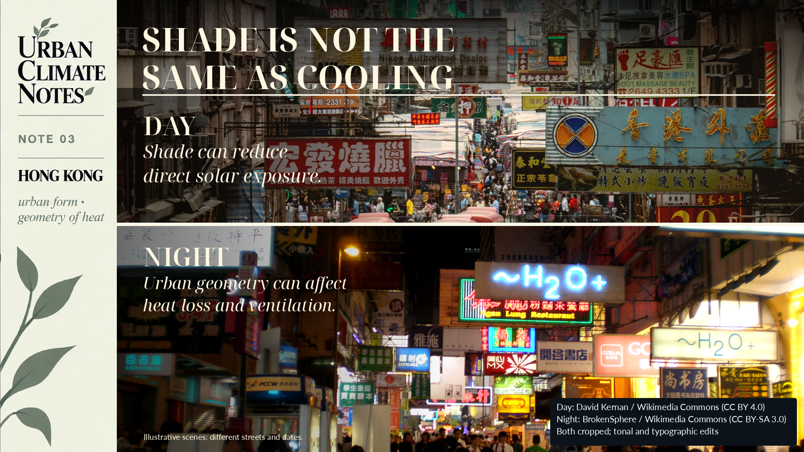
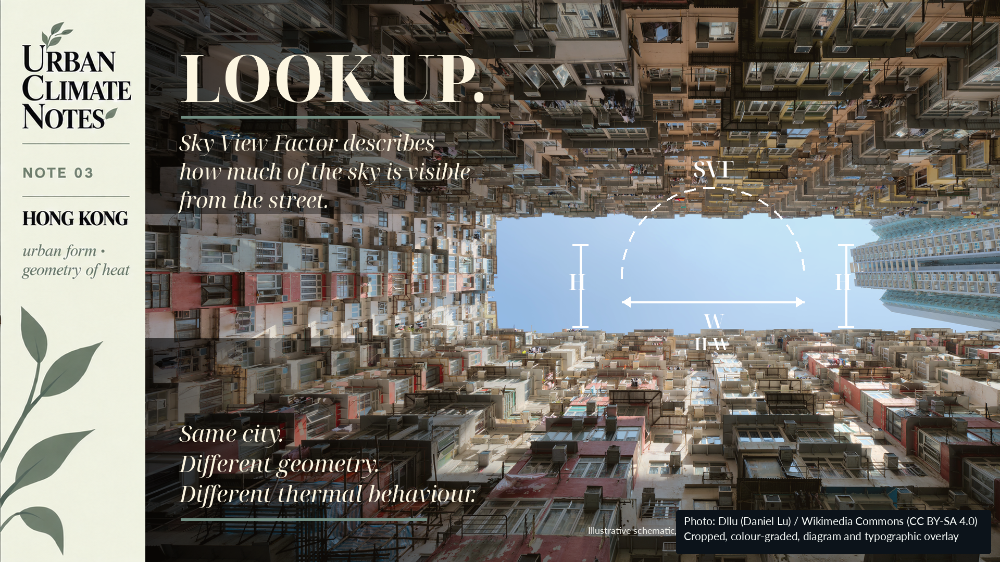
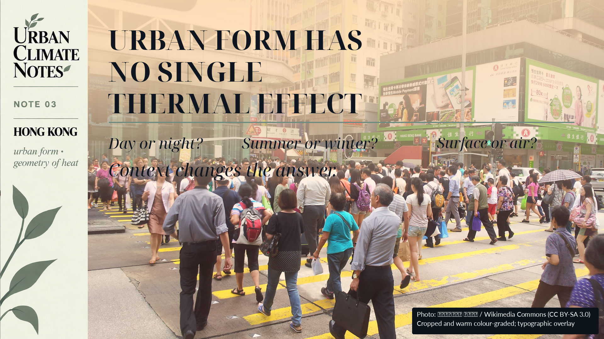

> 前人種樹，後人乘涼。
>
> *Those before us plant the trees; those who come after enjoy the shade.*

This Chinese saying is familiar in Hong Kong, although it did not originate specifically there. In 2018, the Hong Kong government used it while discussing long-term urban greening. [1]

For urban climate, the image is quite literal. A tree planted today may shade a pavement decades from now. Streets and buildings can last just as long. Their height, spacing and orientation influence where sunlight reaches the ground, where shade falls, how much sky is visible and how freely air moves.

In Hong Kong, those relationships can change within a short walk. One street opens toward the sky and prevailing wind; a few blocks away, another sits between closely spaced towers. They share a weather forecast, but the thermal conditions at street level can differ.

How much urban form matters depends on the time of day, the season and the temperature we are measuring. Hong Kong’s research gives us several ways to examine those differences.

## Two streets, one city

Imagine two streets during the same hot afternoon. One is relatively open, with lower or more widely spaced buildings. More sky is visible, and more direct sunlight reaches the ground. The other sits in a deep street canyon. Tall buildings shade much of it for part of the day, restrict its exposure to the sky and alter airflow.

Calling the second street “denser” leaves much of this unexplained. Urban morphology describes the city’s physical configuration: building height and coverage, spacing, street width, orientation, vegetation, open space and their three-dimensional relationships. Two neighbourhoods can have similar development densities and still differ in ways that affect their thermal conditions.

## Shade does not tell the whole story

A building that blocks direct sunlight can make a substantial difference to a pedestrian on a hot afternoon. The same street’s ability to cool after sunset needs a separate look.

Buildings, pavements and other surfaces absorb energy during the day and release some of it later. The Hong Kong Observatory identifies heat stored in buildings, reduced sky exposure, heat from human activities and lower wind speeds in densely developed areas among the mechanisms behind the urban heat island. It describes Hong Kong’s urban heat island as primarily a nighttime phenomenon. [2]

A street canyon may provide useful daytime shade while restricting longwave heat loss or ventilation after sunset. A shaded street is therefore not necessarily one that cools efficiently at night.

{width="100%"}

The same geometry can produce useful daytime shade while affecting radiative cooling and ventilation after sunset.

## Looking at the sky from the ground

Stand in the middle of a street and look up. In an open area, much of the hemisphere above you is visible. Between tall, closely spaced buildings, the opening is smaller. The sky-view factor, or SVF, describes that sky exposure: higher in the open area, lower in the enclosed street.

Its relationship with temperature changes with the conditions being studied.

In 2024, Xu and colleagues combined remotely sensed land surface temperature with mobile air-temperature observations in Hong Kong. They examined floor area ratio, building coverage, SVF, mean building height, road density and vegetation coverage. [3] Floor area ratio describes floor space relative to site area; building coverage describes how much of the ground is occupied by buildings. They capture different aspects of development.

The variables associated with daytime thermal conditions differed from those associated with nighttime conditions. At neighbourhood scale, two-dimensional surface characteristics were particularly important during the day. Both two-dimensional and three-dimensional morphology were relevant at night. [3]

A study led by Sze Ping Hui examined daytime and nighttime land surface temperature during hot and cold periods. SVF was the most influential morphology indicator in their model, but its relationship with surface temperature changed by season and time of day. The nonlinear thresholds differed between January and July, and between day and night. Building height’s thermal relationship also could not be adequately represented by one coefficient or a universal threshold. [5]

These findings give SVF and building height a place in planning analysis, with their interpretation tied to the season, hour and temperature variable being examined.

{width="100%"}

Building height, street width and sky exposure describe different aspects of urban form. Similar density does not necessarily mean similar geometry.

## Predicting temperature is not the same as explaining its cause

Another 2024 Hong Kong study examined 4,474 street-level air-temperature measurements. The researchers compared conventional regression with Random Forest and artificial neural network models. Relationships between urban form and local air temperature were predominantly nonlinear, and the latter two models predicted the observations more accurately than linear regression. [4]

Better prediction does not, by itself, establish cause and effect. It does help show why statements such as “higher buildings make streets hotter” or “lower SVF increases temperature” need qualification. The Hong Kong evidence does not support one rule for every hour and condition.

## How far does a street’s influence extend?

A study in Kowloon combined vehicle-mounted measurements of near-surface air temperature, helicopter-derived land surface temperature and Google Street View imagery. The researchers examined how thermal influences associated with individual streetscape elements persisted as the vehicle moved through the city. [6]

Under the early-evening conditions studied, the combined warming influence associated with land surface temperature, roads and buildings extended laterally up to roughly 40 metres. The cooling influence associated with vegetation was more localised, within roughly 15 metres. [6]

Those distances describe a particular city, method and set of measurement conditions. They cannot be applied as universal design rules.

What interests me is that the thermal influence extended beyond the edge of an individual parcel or feature. For planning, that raises a question about continuity. Could a short segment of planting behave differently from a connected green corridor? What about the continuity of paving materials, building façades or ventilation routes? These are questions to investigate, rather than answers supplied by the two distances alone.

## Reading a heat map

A satellite can identify a hot surface. A weather station measures the air around its sensor. Mobile observations describe conditions along a route at a particular time. We need to keep those differences in view when interpreting a heat map.

Adeniran and colleagues examined daytime and nighttime relationships between air and surface temperature across Hong Kong’s land-use categories and Local Climate Zones in a 2026 study. Surface temperature was an important predictor of air temperature, but models improved when land use, urban configuration and time of day were included. Compact built environments, vegetation and different land-use classes contributed differently to the observed patterns. [7]

Before using a heat map to diagnose a neighbourhood, I would want to know what was measured, at what scale and time, and under which urban conditions.

## What does this mean for planning?

Street widths, building spacing, height patterns and open-space layouts can remain in place for decades. Their thermal consequences deserve attention before construction, while those choices are still easier to change.

Hong Kong’s evidence offers little support for a blanket prescription of lower density or shorter buildings. It directs us toward a more specific question: how does a particular configuration affect solar exposure, ventilation, heat storage and nighttime cooling in the climate of that place?

The answer can inform street proportions, setbacks, building spacing and orientation, as well as vegetation, open-space networks and ventilation corridors. These familiar planning decisions also help shape the climate people experience.

{width="100%" fig-alt="Urban form has no single thermal effect. Context changes the answer."}

Urban morphology interacts with time of day, season and the temperature variable being measured. A single geometric indicator cannot describe every thermal condition.

The old saying leaves us thinking about the shade future residents will inherit. They will inherit the surrounding buildings too, along with street widths, gaps between towers and the amount of sky visible from the pavement. The urban form we leave behind will be part of their climatic environment.

## Next: What temperature are we actually measuring?

Satellites let us observe large areas repeatedly and compare thermal patterns across cities and through time. Much of my own research relies on that capability.

Thermal satellite sensors primarily tell us about land surface temperature. People live in the air above those surfaces. The two temperatures are connected, but they are not interchangeable.

The next Urban Climate Note asks: if a satellite says a neighbourhood is hot, does that mean the air there is equally hot?

## Sources

[1] Development Bureau, Hong Kong SAR Government. (2018). *持續綠化都市 美化生活環境* [Continuing urban greening and improving the living environment].

[2] Hong Kong Observatory. *Urbanization Effect*. Climate Change, Hong Kong Observatory.

[3] Xu, Y., Yang, J., Zheng, Y., Li, W., et al. (2024). *Impacts of two-dimensional and three-dimensional urban morphology on urban thermal environments in high-density cities: A case study of Hong Kong*. **Building and Environment, 252**, 111249. DOI: 10.1016/j.buildenv.2024.111249.

[4] Tian, L., Hao, T., He, X., Chan, I., Niu, J., Chan, P. W., Ng, W. Y., & Huang, J. (2024). *Examining the non-linear relationship between urban form and air temperature at street level: A case of Hong Kong*. **Building and Environment, 264**, 111884. DOI: 10.1016/j.buildenv.2024.111884.

[5] Hui, S. P., Liu, Y., Mohammad, P., & Weng, Q. (2026). *Assessing the diurnal relationship between urban morphology and land surface temperature in a highly dense city: A case study in Hong Kong*. **Remote Sensing Applications: Society and Environment, 41**, 101858. DOI: 10.1016/j.rsase.2025.101858.

[6] Zou, K., Wong, M. S., Nazeer, M., Yu, X., Tan, G., Hou, H., Yang, J., & Chan, P. W. (2025). *Unravelling the street thermal features network and spatial visual thermal inertia: A study in Hong Kong*. **Sustainable Cities and Society, 136**, 107054. DOI: 10.1016/j.scs.2025.107054.

[7] Adeniran, I. A., Nazeer, M., Wong, M. S., Yang, J., & Chan, P. W. (2026). *Diurnal Air–Surface Temperature Dynamics in Hong Kong: An Analysis Across Land Use and Climate Zones*. **International Journal of Climatology, 46**(6), e70297. DOI: 10.1002/joc.70297.
