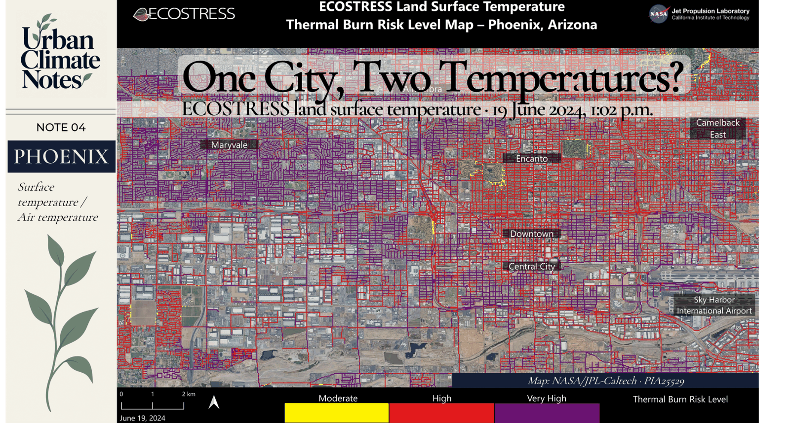
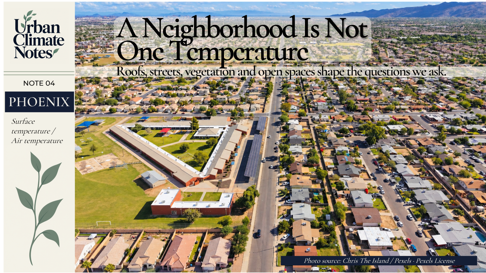
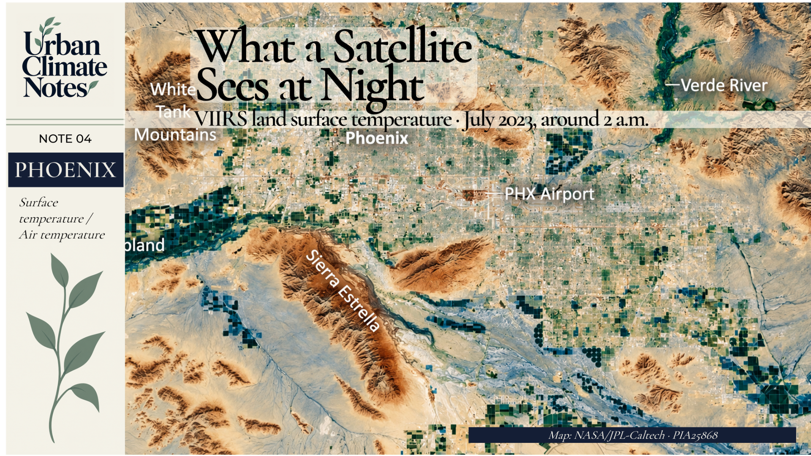

> “Half the Truth is often a great Lie.”
>
> Benjamin Franklin, *Poor Richard's Almanack* (July 1758) [1]

I came back to Franklin’s line while thinking about the temperature maps we produce for cities. A map can accurately describe one part of the urban environment and still mislead us when we treat it as a complete account.

Thermal satellite images reveal patterns we could never see from a single street corner. Yet the colour of a road or rooftop on a map does not, by itself, tell us the temperature of the air a pedestrian breathes. Phoenix offers a clear example.

## One city, two temperatures

At 1:02 p.m. local time on 19 June 2024, NASA’s ECOSTRESS instrument aboard the International Space Station observed surface temperatures across Phoenix. Roads and adjoining sidewalks exceeded 49°C in several parts of the city. Some surfaces around Phoenix Sky Harbor International Airport reached approximately 60°C. The air temperature recorded at the airport that day reached 43°C. [2]

It is tempting to subtract the two airport figures. But the 60°C surface observation and the 43°C daily air-temperature maximum were not taken simultaneously at precisely the same spot. They do not establish a measured 17°C air–surface gap.

They also describe different things. ECOSTRESS observed thermal radiation from exposed surfaces; the airport weather station measured the surrounding air.

The published Phoenix map used a 30-metre grid, produced through machine-learning sharpening that combined ECOSTRESS observations with Landsat and Sentinel-2 information. [2] That processing gives the image more detail, which needs to be interpreted with the method in mind.

{width="100%"}

Phoenix surface temperature and thermal burn risk on 19 June 2024 at 1:02 p.m. local time. This is a satellite-derived map of exposed surfaces, not a measurement of air temperature. Its scale, observation time and legend must remain visible in the published image. Source: NASA/JPL-Caltech, [PIA25529](https://science.nasa.gov/photojournal/nasas-ecostress-maps-burn-risk-across-phoenix-streets/).

## The surface a satellite sees

Thermal infrared instruments detect radiation emitted by the Earth’s surface. Retrieving land surface temperature, or LST, requires accounting for the atmosphere and the emissivity of different materials. [3]

In a city, the sensor may see asphalt, roofs, exposed soil or the upper canopy of a tree. The shaded pavement beneath that tree may be hidden from its view.

Someone walking along the street encounters the air, direct and reflected sunlight, wind and thermal radiation from nearby surfaces. The temperature of a canopy, wall or road contributes to that experience, but none describes it in full.

Air temperature is generally measured with a thermometer shielded from solar radiation and exposed to the ambient air. Nearby surfaces influence it without necessarily sharing its temperature.

This is why I am careful about what I claim from a satellite heat map. It can show where exposed surfaces are warmer. Mapping air temperature requires suitable observations or a model designed to estimate it.

Aerial photographs can help identify the surfaces worth examining. A February 2008 photograph of the former University of Phoenix Stadium in Glendale, within Greater Phoenix, shows a large roof, paved areas and nearby agricultural fields. It cannot tell us which was hottest. The Arizona neighbourhood photograph used in this note similarly shows roofs, streets, school grounds, vegetation and irrigated plots. Those are possible places for further measurement; the photograph itself does not identify a hot spot or quantify exposure.

{width="100%"}

The former University of Phoenix Stadium in Glendale, Greater Phoenix, photographed in February 2008. Different land covers are visible, but their temperatures were not measured in this photograph. Photo: Gerald Nino / U.S. Customs and Border Protection, [U.S. federal public domain](https://commons.wikimedia.org/wiki/File:University_of_Phoenix_Stadium_aerial.jpg); resized and framed.

## When surface and air temperatures diverge

In a 2026 *Nature Communications* study, Yiwen Zhang and colleagues developed a transfer-learning framework to estimate near-surface urban air temperature in 384 cities across the contiguous United States. The estimates covered 2013–2023 at approximately 1-kilometre resolution, around 1:30 a.m. and 1:30 p.m. local time. [4]

These were model estimates, trained and evaluated using available observations. There was no thermometer at every mapped pixel.

Compared with the estimated air temperatures, satellite surface temperatures differed in both magnitude and spatial pattern. Across the cities studied, surfaces tended to be warmer than the air during the day and often cooler at night. The strength of the relationship varied with local climate and location within the city.

The authors also found that substituting satellite LST for near-surface air temperature could overstate the magnitude of urban heat exposure and differences between neighbourhoods. [4] These findings belong to the study’s data, model and US cities. They do not supply a universal conversion factor.

For planning, the neighbourhood comparison deserves particular care. A surface map may show very hot pavements or rooftops without establishing an equally large air-temperature difference from nearby neighbourhoods.

{width="100%"}

Residential neighbourhood in Arizona. The aerial view illustrates land-cover diversity, not observed air or surface temperatures. Photo: [Chris The Island / Pexels](https://www.pexels.com/photo/aerial-view-of-residential-neighborhood-in-arizona-34873755/), Pexels License; resized, cropped and framed.

## The heat a person encounters

Consider two people waiting for public transport in Phoenix on the same afternoon. One stands in direct sunshine; the other is a few metres away beneath a shelter. Their air temperatures might be nearly identical, while their exposure to solar radiation differs substantially. Wind, humidity and the warmth of surrounding surfaces also affect how much heat their bodies gain or lose.

The Heat Index combines air temperature and relative humidity and is generally interpreted for shaded conditions. Wet Bulb Globe Temperature, or WBGT, incorporates additional influences, including radiant exposure and wind. Neither index is interchangeable with satellite LST. [5]

To evaluate a bus stop, pedestrian route or schoolyard, we need measurements suited to the conditions people encounter there. A satellite map can help us choose where to investigate more closely.

## What stays warm after sunset?

Phoenix also brings us back to Tokyo and the question of nighttime cooling in Urban Climate Notes 02.

During the July 2023 heatwave, NASA researchers examined Phoenix surface-temperature observations from VIIRS aboard the NOAA–NASA Suomi NPP satellite. The observations were collected at about 2 a.m. on several nights. Some built surfaces remained near 38°C, and the mapped surfaces became progressively hotter during part of the heatwave. [7]

These observations describe nighttime surfaces, rather than directly measuring the air two metres above the ground. They help us examine the role of materials and heat storage in the nighttime thermal environment.

Surface and atmospheric urban heat islands can differ in strength, timing and location. The observation time and method are therefore part of interpreting the map.

{width="100%"}

Nighttime land surface temperature in the Phoenix region during the July 2023 heatwave. VIIRS observations were collected at about 2 a.m.; this is not a map of near-surface air temperature. The published graphic should preserve the original NASA map, geographic labels and temperature interpretation. Source: NASA/JPL-Caltech, [PIA25868](https://science.nasa.gov/photojournal/phoenix-land-surface-temperatures-documented-amid-record-heat/) (VIIRS on NOAA–NASA Suomi NPP).

## What does a 30-metre pixel mean?

A fine output grid can look more precise than the observations supporting it.

Landsat 8 and 9 collect thermal infrared measurements at a native spatial resolution of 100 metres. Their thermal data are commonly resampled to 30-metre pixels. Resampling does not create independent 30-metre thermal observations. [6]

The 2024 Phoenix ECOSTRESS map used a different process: its 30-metre output was sharpened with information from other satellites. [2] Its visual detail needs to be considered alongside the instrument resolution and the assumptions of that method.

Clouds, emissivity, observation time and retrieval uncertainty also affect the analysis. Describing these limits helps us interpret what the imagery can support.

## Which temperature does planning need?

My own research uses satellite LST to investigate urban morphology, land-cover change and surface heating. Repeated observations allow me to study redevelopment and vegetation loss across large areas, including places with few ground-based sensors.

If a wooded parcel is cleared and replaced by buildings and pavement, satellite imagery can help document the transformation and associated changes in surface temperature. A question about warmer nighttime air around nearby homes requires air-temperature evidence. A question about pedestrians calls for closer attention to shade, radiation and wind. The measurement needs to suit the decision.

Franklin’s warning returns here: accurate evidence can mislead when we ask it to stand for more than it measures. I will continue using thermal satellite imagery. When a map identifies a hot neighbourhood, I want to know which surfaces it shows, when they were observed and whether the evidence supports a conclusion about the people living there.

The map tells us where to look. We still have to decide what to measure when we get there.

## Sources

[1] Franklin, B. (1758). *Poor Richard's Almanack*, July: “Half the Truth is often a great Lie.” [Historical transcription](https://usinfo.org/enus/government/overview/bf1758.html); [Metropolitan Museum of Art](https://www.metmuseum.org/ja/perspectives/historical-almanacs).

[2] NASA/JPL-Caltech. (2024). [*NASA's ECOSTRESS Maps Burn Risk Across Phoenix Streets*](https://science.nasa.gov/photojournal/nasas-ecostress-maps-burn-risk-across-phoenix-streets/). NASA Photojournal, PIA25529.

[3] NASA Earth Observatory. [*Land Surface Temperature*](https://science.nasa.gov/earth/earth-observatory/global-maps/land-surface-temperature/).

[4] Zhang, Y., Zhao, L., Chakraborty, T., Mazumdar, P., Zhang, K., & Gentine, P. (2026). [*Transfer learning reveals large discrepancies between air and land surface temperatures in cities*](https://doi.org/10.1038/s41467-026-73716-7). *Nature Communications, 17*, 6890.

[5] NOAA National Weather Service. [*Wet Bulb Globe Temperature vs Heat Index*](https://www.weather.gov/ict/wbgt); [NOAA Heat Index explanation](https://www.noaa.gov/jetstream/synoptic/heat-index).

[6] NASA. [*Landsat 8: Thermal Infrared Sensor*](https://science.nasa.gov/mission/landsat-8/); [*Landsat spectral bands and applications*](https://science.nasa.gov/mission/landsat/spectral-bands-and-applications/).

[7] NASA/JPL-Caltech. (2023). [*NASA Data Shows Fierce Surface Temperatures During Phoenix Heat Wave*](https://www.nasa.gov/centers-and-facilities/jpl/nasa-data-shows-fierce-surface-temperatures-during-phoenix-heat-wave/); [NASA Photojournal image](https://science.nasa.gov/photojournal/phoenix-land-surface-temperatures-documented-amid-record-heat/).

## Image sources and use notes

- **Cover — Phoenix skyline, 2009:** Bigmikebmw, [*Phoenix, Arizona.JPG*](https://commons.wikimedia.org/wiki/File:Phoenix,_Arizona.JPG), Creative Commons [CC BY-SA 3.0](https://creativecommons.org/licenses/by-sa/3.0/). Adaptation: resized/cropped, overlaid title and branding. The edited cover artwork containing this photograph must retain the applicable CC BY-SA 3.0 attribution and share-alike obligations.
- **Surface-temperature map — June 2024:** NASA/JPL-Caltech, [ECOSTRESS PIA25529](https://science.nasa.gov/photojournal/nasas-ecostress-maps-burn-risk-across-phoenix-streets/). Source map with the original legend, time and temperature scale; 1:02 p.m. local time, 19 June 2024. Do not alter its mapped data.
- **Large surfaces — Glendale stadium, February 2008:** Gerald Nino/U.S. Customs and Border Protection, [*University of Phoenix Stadium aerial.jpg*](https://commons.wikimedia.org/wiki/File:University_of_Phoenix_Stadium_aerial.jpg), U.S. federal public domain. The stadium is in Glendale, within Greater Phoenix. Presentation: resized/cropped and arranged with a separate text panel.
- **Neighbourhood aerial — Arizona:** Chris The Island, [Pexels photo 34873755](https://www.pexels.com/photo/aerial-view-of-residential-neighborhood-in-arizona-34873755/), [Pexels License](https://www.pexels.com/license/). Presentation: resized/cropped and arranged with a separate text panel.
- **Night surface-temperature map — July 2023:** NASA/JPL-Caltech, [VIIRS PIA25868](https://science.nasa.gov/photojournal/phoenix-land-surface-temperatures-documented-amid-record-heat/). Source map/labels must be preserved; observations around 2 a.m. on selected dates in July 2023.

NASA [media-use guidelines](https://www.nasa.gov/nasa-brand-center/images-and-media/) apply; NASA did not endorse this article. Each photograph is illustrative unless accompanied by an explicit temperature dataset.
